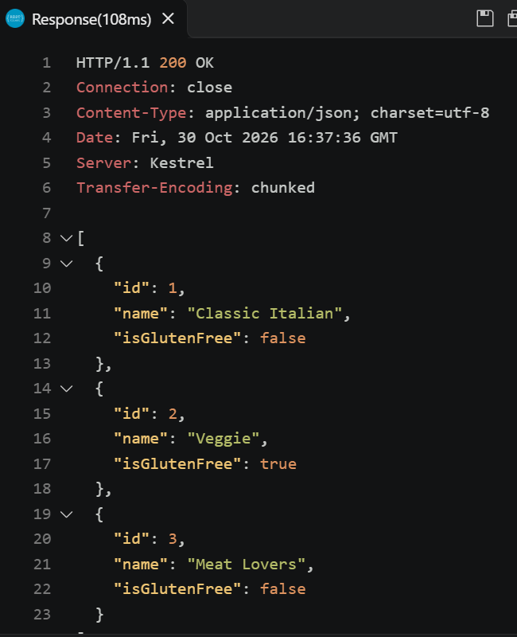

## 1. Pizza Seed Data

The following screenshot shows the API response containing the existing pizzas
and the additional pizza I added to the `Pizzas` list in `PizzaService`.




## 2. API Operations

### GET

**Request:**

```http
GET /pizza/1
Accept: application/json
```

**Response:**

```json
{
    "id": 1,
    "name": "Classic Italian",
    "isGlutenFree": false
}
```

**Status code:** `200 OK`

### POST

**Request:**

```http
POST /pizza/
Content-Type: application/json

{
    "name": "Hawaii",
    "isGlutenFree": false
}
```

**Response:**

```json
{
    "id": 4,
    "name": "Hawaii",
    "isGlutenFree": false
}
```

**Status code:** `201 Created`

### PUT

**Request:**

```http
PUT /pizza/3
Content-Type: application/json

{
    "id": 3,
    "name": "Hawaiian",
    "isGlutenFree": false
}
```

**Response:**

No response body.

**Status code:** `204 No Content`

### DELETE

**Request:**

```http
DELETE /pizza/3
```

**Response:**

No response body.

**Status code:** `204 No Content`


## 3. Sales Summary Function

```csharp
double GetSalesTotalFromFile(string file)
{
    string salesJson = File.ReadAllText(file);
    SalesData? data = JsonConvert.DeserializeObject<SalesData?>(salesJson);
    return data?.Total ?? 0;
}
```
